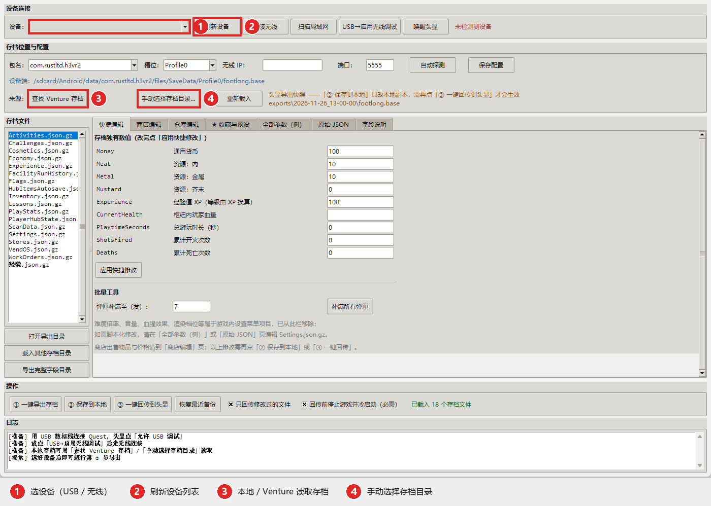
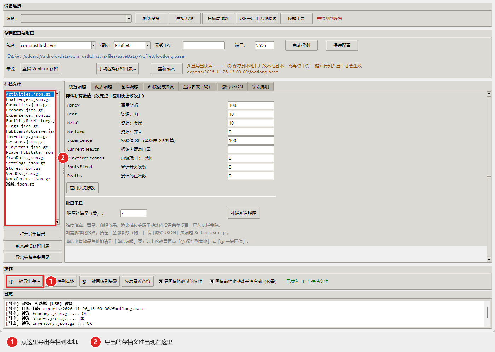
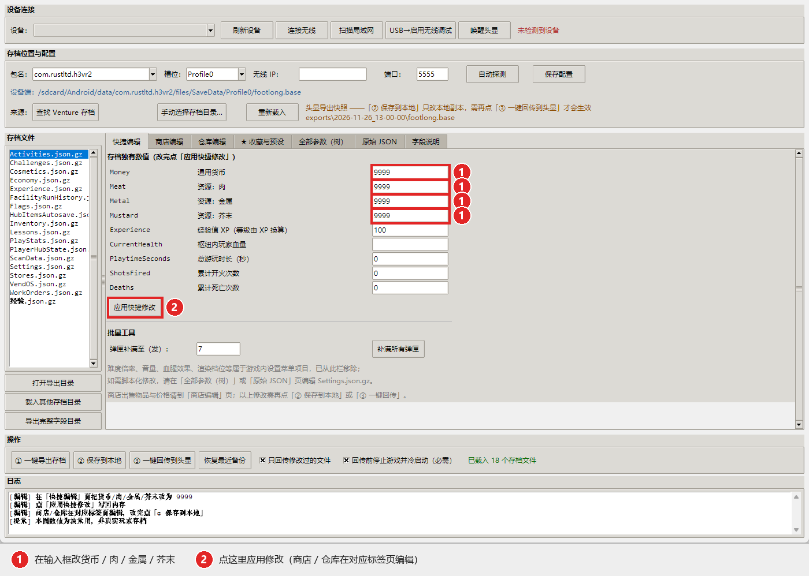
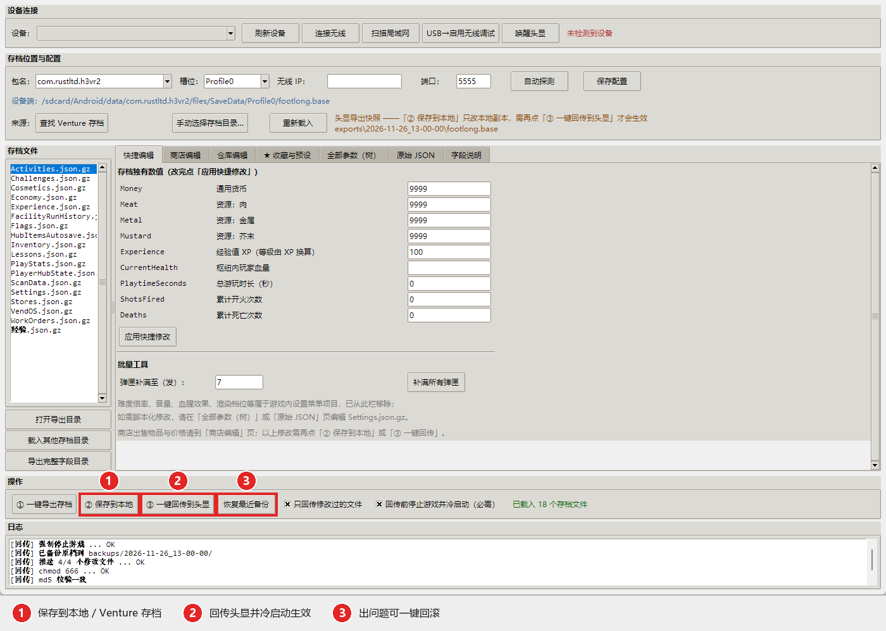

# H3VR2 存档编辑器

 ·  ·  · [项目页](https://leonnagant.github.io/h3vr2-save-editor/) · [下载 v0.4.0](https://github.com/LeonNagant/h3vr2-save-editor/releases/tag/v0.4.0)

改 H3VR2 单机存档里的**数值、商店物品与价格、玩家仓库**，并把修改真正写回设备使其生效。
Windows 便携版自带 Python 与 adb，**无需安装任何依赖**，解压即用。

> **非官方第三方工具**：与游戏开发者、发行方、平台方无关联，仅用于编辑你自己的单机离线存档。
> 本项目**使用 AI 生成辅助**，详见 [DISCLAIMER.md](DISCLAIMER.md)。

---

## 四步改存档（跟着图做）

> 下面四张图是 **v0.4.0 真实界面**的操作演示：**红框**标出要点的按钮 / 输入框，**圆圈数字**是操作顺序，
> 图片底部图例说明每步做什么。图中数值为演示用，非真实玩家存档。

### ① 连接设备 / 本地读取存档

插 USB 数据线并在头显点「允许 USB 调试」，点「刷新设备」后在下拉框选中 `[USB]` 设备；
也可点「USB→启用无线调试」改用无线。不连头显时，可用「查找 Venture 存档」或「手动选择存档目录」读取本地存档。

### ② 一键导出存档

点底部「① 一键导出存档」，程序把头显上的存档导出到 `exports/<时间戳>/footlong.base/`，
左侧文件列表会列出导出的文件。

### ③ 修改内容

在「快捷编辑」页改货币 / 肉 / 金属 / 芥末等数值后点「应用快捷修改」；商店与仓库在对应标签页编辑。
改完点「② 保存到本地」把修改写入本机副本。

### ④ 传回设备 / 保存到本地目录

点「③ 一键回传到头显」：程序自动**停游戏 → 备份 → 推送 → 校验 → 冷启动**，改动即刻生效。
本地 / Venture 存档则点「②」直接写回对应目录；改坏了点「恢复最近备份」回滚。

> **关键**：游戏只在**启动时读档**，运行中会把内存旧值写回文件。所以务必保持底部
> 「回传前停止游戏并冷启动（必需）」勾选，否则修改看起来「没效果」。

---

## 下载与运行

| 项目 | 内容 |
|---|---|
| 当前版本 | **v0.4.0**（2026-11-26） |
| 下载 | [GitHub Releases · v0.4.0](https://github.com/LeonNagant/h3vr2-save-editor/releases/tag/v0.4.0) → `H3VR2-Save-Editor-v0.4.0-Windows-Portable.zip` |
| 运行 | 解压整个压缩包（支持中文路径）→ 双击 `启动存档编辑器.bat`；窗口没出现就双击 `启动-调试模式.bat` 看报错 |
| 环境 | Windows 10/11 64 位 + Meta Quest（开发者模式 / USB 调试）；也支持 PC 端 Venture 模拟器 |
| 依赖 | 无需安装：便携版自带 Python 3.10.5（含 tkinter）与 adb，零第三方 pip 依赖 |

从源码运行（开发者）：`git clone` 后 `py -3.10 h3vr2_save_editor.py`（需自带 tkinter 的 Python，`adb.exe` 在 PATH 或写入 `config.json`）。

---

## 能改什么

| 类别 | 内容 |
|---|---|
| 数值 | 货币、肉、金属、芥末、经验、血量、游玩统计；弹匣补满 |
| 商店 | 684 种物品可选，改出售物品 / 售价 / 分区；增删货位、打折、统一定价 |
| 仓库 | 多页 12×8 网格，换物品、改占格与位置、复制 / 删除 / 新增槽位 |
| 预设 / 收藏 | 保存编辑内容为预设，导出新存档一键还原；收藏快速定位并批量加入 |
| 全部字段 | 「全部参数（树）」逐字段改、「原始 JSON」整段编辑、「字段说明」生成中文说明 |

游戏更新后物品变了？用附带的**物品表生成器**（`tools/`）从自己的安装包读取新物品、增量更新物品表，见 [工具说明](tools/README.md)。

---

## 进阶与开发者文档

想了解细节、排查问题或参与开发，请读二级文档：

- **[用户指南（进阶）](docs/USER-GUIDE.md)** —— 连接与传输细节、7 个标签页详解、预设 / 收藏结构、
  Venture 模拟器、包名策略、存档结构与字段、完整配置项、生效原理与回滚、常见问题
- **[物品表生成器用法](tools/README.md)** —— 游戏更新后从安装包 / hdog / 根包读取新物品
- [贡献指南](CONTRIBUTING.md) · [免责声明与 AI 辅助说明](DISCLAIMER.md) · [更新日志](CHANGELOG.md) · [版本摘要](VERSION.txt)

---

## 项目说明

H3VR2 单机存档以 gzip 压缩的 JSON 存在头显上。本项目把它们解析成可读字段，提供纯本地图形界面修改，
并解决「改了不生效」的实际问题（游戏启动时读档、运行中写回，故回传须停游戏 + 冷启动）。

**设计原则**：不碰游戏本体（只读写存档 JSON，不改 APK / OBB、不注入、不绕过授权或内购）·
纯本地零依赖（无账号、无遥测、无上报）· 默认只认官方包名 `com.rustltd.h3vr2` ·
可回滚（回传前自动备份）· 编辑内容与存档分离（预设存 `presets.json`）。

单元测试 **103/103 通过**，发布包脱敏扫描 0 命中，仓库与发布包均不含玩家存档数据。
详见 [用户指南 · 生效原理](docs/USER-GUIDE.md#8-生效原理风险与回滚)。

---

## 声明

- **AI 生成辅助**：源码、文档、物品目录与页面均由 AI 辅助生成并经人工审阅与测试，详见 [DISCLAIMER.md](DISCLAIMER.md)。
- **非官方**：与游戏开发者、发行方、平台方无关联；游戏名称与商标归各自权利人。
- **包名政策**：默认且仅列出官方包名 `com.rustltd.h3vr2`；不预置、不推荐、不宣传改包名分发的第三方版本或付费汉化。
- **使用范围**：仅自己的单机离线存档；不修改游戏本体，不绕过授权或内购，不收集或上传任何数据。
- **风险**：按「现状」提供，操作前请自行备份；完整条款见 [DISCLAIMER.md](DISCLAIMER.md)。
- **许可**：本仓库原创代码与文档为 [MIT](LICENSE)；便携版内附带的 Python 3.10.5 与 adb 分别遵循 PSF License / Apache-2.0。

---

*最后更新：2026-11-26 · v0.4.0*
